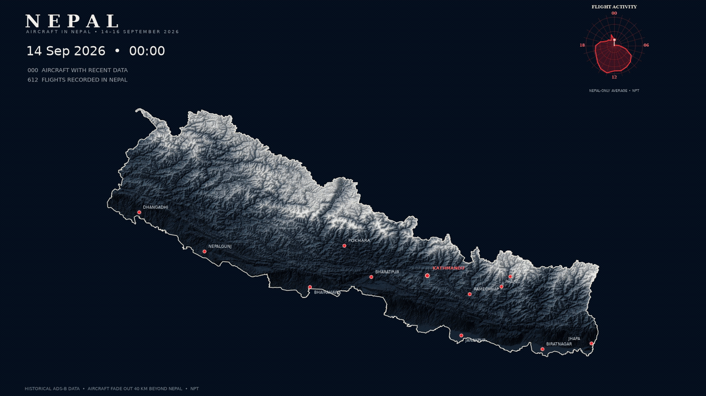

# Nepal Aviation in Motion

I wanted to explore how aircraft movements across Nepal could be visualized against the country's mountainous terrain. This project brings together historical flight data, elevation data, and Python to create an animated view of aircraft activity over three days, from 14 to 16 September 2026 (Nepal Standard Time).

The map shows the aircraft positions and flight trails over a shaded-relief view of the Himalayas. Flight paths can continue up to 40 km beyond Nepal's border, gradually fading out instead of stopping abruptly at the boundary.

### The animation

<p align="center">
  
</p>


### How it was built

The project uses Python to process the flight trajectories and render the animation. The map combines terrain shading, Nepal's boundary, airport markers, aircraft positions, and their recent trails.

Tools and libraries used include Python, NumPy, Pandas, Matplotlib, Rasterio, Shapely, PyProj, Pillow, and FFmpeg.

### Running it yourself

You'll need Python 3.13, Git, and FFmpeg installed on your computer.

Clone the repository:

```bash
git clone https://github.com/prakash023/Nepal-aviation-in-motion.git
cd Nepal-aviation-in-motion
```

Create a virtual environment and install the Python packages:

```powershell
py -3.13 -m venv .venv
.\.venv\Scripts\Activate.ps1
python -m pip install --upgrade pip
pip install -r requirements.txt
```

### Getting the data

The flight trajectories, Nepal boundary, and DEM are not included in this repository. You'll need to obtain the datasets separately and check the relevant usage terms.

I've included a Python script for downloading the DEM tiles in `scripts/download_nepal_dem_tiles.py`. Check the download source and file paths in the script before running it:

```bash
python scripts/download_nepal_dem_tiles.py
```

Once the required data is available, update any file paths that need adjusting and run the animation script:

```bash
python scripts/v3_animate_nepal_aviation_3days_40km_fade.py
```

The scripts currently may contain paths specific to my own computer, so some configuration will be needed before running them on another machine.

### Inspiration

I've taken inspiration from geospatial visualizations shared by creators such as [Milos GIS](https://x.com/milos_gis), along with other projects from the GIS and mapping community. Seeing what people create with geospatial data encouraged me to experiment with aviation movements and terrain visualization in Nepal.

This is my own implementation, focused on Nepal and the Himalayan region. Any third-party code or data used should be credited according to its licence.

### A note on the data

This animation represents historical flight data; it is not a live aircraft-tracking service. The results depend on the coverage and quality of the source data.

No project licence has been added yet, so please check the relevant licences before reusing the code or any third-party data.